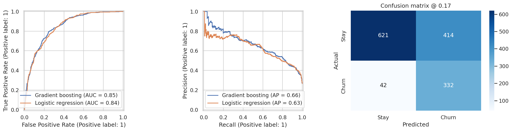

# Customer Churn Prediction for a Telecom Provider

> Predicting which telecom customers are about to cancel, and choosing *who to contact* so that a retention campaign is profitable. Built with scikit-learn.

**Dataset:** IBM Telco Customer Churn (7,043 customers, 21 features) · **Tools:** Python, pandas, scikit-learn, matplotlib, seaborn

## Business Problem
A telecom provider loses revenue every time a customer cancels, and retention offers cost money. The question is not only "who will churn?" but **"which customers should we contact so the campaign earns more than it costs?"**

## Approach
1. **Data validation:** fix `TotalCharges` stored as text, confirm the blank rows are brand-new customers (`tenure = 0`), check duplicates.
2. **EDA:** churn rate by contract, internet service, payment method and tenure.
3. **Feature engineering:** number of add-on services, autopay flag, average charge per tenure month.
4. **Modeling:** logistic regression baseline vs. tuned gradient boosting, 5-fold stratified cross-validation, metrics focused on PR-AUC because the classes are imbalanced.
5. **Business-driven threshold:** the decision threshold maximizes expected campaign profit (retention cost, offer success rate, margin), chosen on out-of-fold predictions, not on the test set.
6. **One-shot test evaluation:** ROC/PR curves, confusion matrix, lift table.
7. **Explainability:** permutation importance and partial dependence plots.

## Key Decisions
| Issue | Decision |
|---|---|
| Churn is imbalanced (26.5% of customers) | Use PR-AUC and a profit-based threshold; accuracy is not reported as the main metric |
| Blank `TotalCharges` values | Verified they are `tenure = 0` customers (11 rows), then set to 0 |
| Risk of data leakage | Test set split first; all preprocessing inside a `Pipeline` |
| Complex model vs. simple model | Gradient boosting is kept only if it clearly beats logistic regression |
| Threshold at 0.5 is arbitrary | Threshold chosen by expected profit, with stated assumptions |

## Project Structure
```
notebooks/churn_prediction.ipynb   -- full analysis, from data validation to model saving
data/                              -- place the CSV here (not committed)
models/                            -- saved model + threshold (generated)
images/                            -- charts for this README
requirements.txt
```

## How to Run
```bash
git clone https://github.com/andikapratamazaid/telco-churn-prediction.git
cd telco-churn-prediction
pip install -r requirements.txt
# download the dataset into data/ (see data/README.md)
jupyter notebook notebooks/churn_prediction.ipynb
```

## Results
All numbers below are the actual output of the executed notebook in this repo.

| Model | CV PR-AUC (out-of-fold) | Test ROC-AUC | Test PR-AUC |
|---|---|---|---|
| Logistic regression | 0.655 | 0.842 | 0.632 |
| Gradient boosting (tuned) | 0.660 | 0.846 | 0.662 |

- **Model kept:** gradient boosting. The out-of-fold gap over logistic regression is small (0.660 vs. 0.655 PR-AUC), but on the held-out test set it is clearer (0.662 vs. 0.632 PR-AUC), so the tuned model is retained.
- **Chosen threshold:** 0.17 (from the profit curve on out-of-fold predictions) → on the test set it contacts **52.9% of customers** (746 of 1,409) and captures **88.8% of churners** at 44.5% precision.
- **Expected profit at that threshold:** $103,066 on the training out-of-fold predictions (vs. $76,649 for contacting everyone and $0 for contacting nobody) and **$24,076 on the test set**, under the stated assumptions ($15 contact cost, 30% offer success rate, 12-month value horizon, 40% margin).
- **Top 10% of scored customers** contain **28.3% of all churners** (75.2% churn rate in that decile); the top 20% contain 50.3%.
- **Main churn drivers** (permutation importance, drop in test PR-AUC): **Contract** (~0.12), **tenure** (~0.11), **TotalCharges** (~0.03), followed by TechSupport, InternetService and OnlineSecurity (~0.02 each).



## Business Recommendations
| Finding | Action |
|---|---|
| Month-to-month customers churn at 42.7%, vs. 11.3% (one-year) and 2.8% (two-year) | Offer an incentive to move to a longer contract, targeted at high-score month-to-month customers |
| Customers in their first 6 months churn at 52.9%; risk falls steadily with tenure | Onboarding and early-life check-ins in the first months, when risk is concentrated |
| Electronic-check payers churn at 45.3%, vs. 15-17% for automatic payment methods | Encourage autopay enrollment, e.g. a small discount for switching |
| Fiber-optic customers churn at 41.9%, more than double DSL (19.0%) | Review fiber pricing and service quality; the premium segment is the least loyal |
| Customers without TechSupport or OnlineSecurity churn more (both rank in the top importance list) | Bundle support/protection add-ons into retention offers for high-score customers |

## Limitations
- Single snapshot with no timestamps, so there is no temporal validation.
- Cost, success-rate and margin figures are **assumptions**; replace them with real company numbers.
- Predicting who churns is not the same as predicting who responds to an offer; an uplift model or an A/B test would address this.
- Probabilities are not explicitly calibrated.

## Next Steps
- SHAP explanations and a fairness check across customer groups
- Probability calibration
- Uplift modeling
- Monitoring plan for data drift

## Related Project
[Data Science for a Mining Company: EDA to API & Docker](https://github.com/andikapratamazaid/data-science-pertambangan)

## Author
**Andika Pratama Zaid** · [GitHub](https://github.com/andikapratamazaid)
